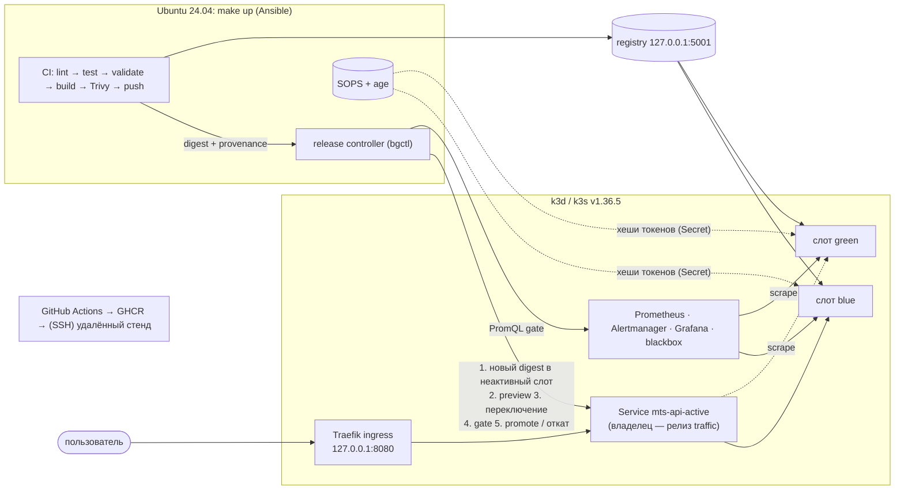

# Облачный DevOps-конвейер: от репозитория до production-Kubernetes за 3 команды

Кейс 1 МТС (DevOps). Воспроизводимый шаблон платформы доставки небольшого REST API:
по изменению кода проходят тесты, сборка и сканирование образа; новая версия разворачивается
**отдельно от рабочей**, проверяется, получает пользовательский трафик, а при деградации конвейер
**сам возвращает трафик** на прежнюю здоровую версию и сохраняет отчёт о произошедшем.

```bash
git clone https://github.com/mitrcik/MTS_DEVOPS_TASK.git mts-devops
cd mts-devops
make up
```

> До слияния в `main` код находится в ветке `claude/friendly-ride-7k6cyd`:
> `git clone -b claude/friendly-ride-7k6cyd https://github.com/mitrcik/MTS_DEVOPS_TASK.git mts-devops`.

**Быстрый маршрут проверки для жюри** (после `make up`, ~5 минут без учёта ожидания):

```bash
make verify            # API через ingress, токен, Prometheus targets, алерты, Grafana — 14 проверок
make release VERSION=v2    # обычный релиз: новый слот → проверки → переключение → promoted
make demo-failure      # дефект после переключения → автоматический возврат трафика (rolled_back)
make demo-alert        # реальный сбой → алерт firing → восстановление → resolved
make rotate-secret     # ротация API-токена: новый работает во всех pod, старый отклоняется
make verify-security   # non-root, read-only FS, NetworkPolicy, RBAC, шифрование Secret — 17 проверок
make status            # активный слот, версии, история решений
```

Полный приёмочный прогон: `make test-e2e` (15 сценариев). Матрица требований —
[`docs/requirements.md`](docs/requirements.md), фактические результаты — [`docs/validation/`](docs/validation/).

---

## 1. Название кейса

«Облачный DevOps-конвейер: от репозитория до production-Kubernetes за 3 команды» (кейс 1).

## 2. Описание проблемы

Типичный путь «код → прод» для микросервиса часто собран вручную: образ собирается на машине
разработчика, тег `latest` перезаписывается, выкладка идёт поверх рабочей версии, а откат — это
ручная операция после жалоб пользователей. Секреты лежат в открытом виде в конфигурации, метрики
и алерты появляются позже, чем инциденты. Такой путь невоспроизводим и непрозрачен: нельзя
доказать, что в production работает именно проверенный артефакт, и нельзя быстро и безопасно
вернуться к рабочей версии.

## 3. Цель работы

Сделать воспроизводимый за три команды стенд, где:

- каждое изменение проходит lint, тесты, проверку конфигурации, сборку, сканирование Trivy и
  публикацию **ровно того же** артефакта по digest;
- релиз — blue-green: новая версия разворачивается в неактивный слот, проверяется до и после
  переключения трафика, а при деградации трафик автоматически возвращается;
- секреты хранятся зашифрованными (SOPS + age), ротация проверяема;
- есть метрики, дашборд, алерты и runbook, а каждый релиз оставляет отчёт из фактических данных.

## 4. Состав команды

> Заполняет команда — данные участников не выдумываются.

| Участник | Роль | Опыт и навыки |
|---|---|---|
| _ФИО_ | _например: DevOps-инженер, владелец конвейера_ | _…_ |
| _ФИО_ | _например: разработчик демо-сервиса, наблюдаемость_ | _…_ |
| _ФИО_ | _например: безопасность, документация, видео_ | _…_ |

## 5. Архитектура



Подробно (поток артефакта, машина состояний релиза, секреты, ограничения и путь к HA):
[`docs/architecture.md`](docs/architecture.md). Решения и их основания: [`docs/decisions.md`](docs/decisions.md).

**Демо-приложение** (`app/`): синтетический каталог тарифов и расчёт месячной стоимости
(данные условные, не тарифы МТС):

| Метод | Назначение |
|---|---|
| `GET /api/v1/tariffs`, `GET /api/v1/tariffs/{id}` | каталог (публичный) |
| `POST /api/v1/quotes` | расчёт стоимости; требует `Authorization: Bearer <токен>` из Kubernetes Secret; валидация ввода (422), неизвестный тариф (404) |
| `GET /healthz`, `GET /readyz` | жизнеспособность / готовность |
| `GET /version` | версия, Git SHA, время сборки, release id, слот |
| `GET /metrics` | метрики Prometheus (метки — шаблоны маршрутов, без неограниченной кардинальности) |

Учебные неисправности зашиваются в образ при сборке (`FAULT=not-ready` / `errors-behind-ingress`),
по умолчанию выключены и не управляются никаким endpoint.

## 6. Использованные инструменты

Версии зафиксированы 2026-10-15 по правилу «последний стабильный выпуск, опубликованный не позже
2026-10-01» (D14). Всё, кроме системных предпосылок, ставится в `.local/` проекта.

| Инструмент | Версия | Источник установки и проверка |
|---|---|---|
| Ubuntu (хост) | 24.04 LTS x86_64 | основной поддерживаемый профиль |
| Docker Engine + buildx | ≥ 24 (проверено 29.8.2 и на runner GitHub) | Docker CE или `docker.io` + `docker-buildx` из Ubuntu |
| Python (хост) | ≥ 3.12 | `python3`, `python3-venv` из Ubuntu |
| ansible-core / yamllint / ruff | 2.21.4 / 1.38.0 / 0.16.9 | PyPI, `pip --require-hashes` (`infra/tooling/requirements.lock`) |
| k3d | 5.9.0 | GitHub Releases, sha256 из `checksums.txt` |
| k3s | v1.36.5+k3s1 | образ `rancher/k3s` (Docker Hub) |
| kubectl | 1.36.5 | dl.k8s.io, `.sha256` |
| Helm | 4.3.0 | get.helm.sh, `.sha256sum` |
| SOPS / age | 3.13.1 / 1.3.1 | GitHub Releases, sha256 |
| Trivy | 0.75.0 (БД — mirror.gcr.io) | GitHub Releases, sha256 из `trivy_0.75.0_checksums.txt` |
| Traefik | 3.7.13 | встроен в k3s |
| Registry | 3.1.2 | `registry:3.1.2` (Docker Hub) |
| Prometheus / Alertmanager | v3.13.4 / v0.34.1 | `prom/*` (Docker Hub) |
| Grafana | 13.2.3 | `grafana/grafana` (Docker Hub) |
| blackbox exporter | v0.28.0 | `prom/blackbox-exporter` |
| Приложение | Python 3.13 на Alpine 3.24; FastAPI 0.142.2, uvicorn 0.54.0, prometheus-client 0.26.0, pydantic 2.13.5 | PyPI, `app/requirements.lock` (хеши) |
| Тесты | pytest 9.1.1, httpx 0.28.1; shellcheck 0.11.0 (контейнер) | `app/requirements-dev.lock` |
| GitHub Actions | checkout v7.0.1, upload-artifact v7.0.2, download-artifact v7.0.0 | закреплены по commit SHA |

`make doctor` печатает фактические версии; таблица источников — `infra/tools/tools.yml`, `versions.env`.

## 7. Как запустить

### Предпосылки хоста (однократно, требуют sudo)

```bash
sudo apt-get update
sudo apt-get install -y git make curl python3-venv docker.io docker-buildx   # или Docker CE
sudo usermod -aG docker "$USER" && newgrp docker     # доступ к Docker = привилегированный доступ к хосту
```

Ресурсы: цель проекта 4 vCPU / 8 ГБ RAM (фактически стенд занимает ≈ 1,6 ГиБ RAM в покое),
~8 ГБ диска под образы, интернет до Docker Hub, ghcr.io, GitHub Releases, dl.k8s.io, get.helm.sh,
PyPI, mirror.gcr.io. Свободные порты на `127.0.0.1`: 8080 (ingress), 6550 (Kubernetes API), 5001 (registry).
Правка `/etc/hosts`, домен, публичный IP и GitHub-токен **не нужны**.

### Три команды

```bash
git clone https://github.com/mitrcik/MTS_DEVOPS_TASK.git mts-devops
cd mts-devops
make up
```

`make up` (идемпотентно, ограниченные таймауты, ненулевой код при ошибке):

1. `doctor`: ОС, Docker/buildx, ресурсы, диск, порты, конфликтующие объекты, доступ к источникам;
2. venv с ansible-core и линтерами (по хешам), CLI-инструменты в `.local/bin` (по sha256);
3. age-ключ и зашифрованный SOPS-источник учебных секретов (только если их ещё нет);
4. k3d-кластер с registry и шифрованием Secret, ожидание узла и Traefik;
5. платформа: namespace с PSA, default-deny NetworkPolicy, RBAC релизов, ограниченный kubeconfig;
6. наблюдаемость; ожидание готовности Prometheus, Alertmanager, Grafana;
7. полный CI начальной версии `v1` и blue-green релиз (если здорового активного релиза ещё нет);
8. smoke-проверка `bgctl verify` и итог: адреса, активный слот/версия/digest.

**Ожидаемый результат.** Последний блок вывода — адреса и `[ACTIVE ] blue версия=v1`.
Холодный старт на чистом runner GitHub (Ubuntu 24.04): **3 мин 21–25 с** (3 прогона); повторный `make up` на
работающем стенде ничего не меняет (≈ 20 с). Замеры — [`docs/validation/`](docs/validation/).

| Адрес (только loopback) | Что |
|---|---|
| http://127.0.0.1:8080/api/v1/tariffs | API (пользовательский путь); `/version`, `/docs` |
| http://grafana.localhost:8080 | Grafana (логин `admin`, пароль: `make credentials`) |
| http://prometheus.localhost:8080 | Prometheus (targets, alerts) |
| http://alertmanager.localhost:8080 | Alertmanager |

Если браузер не резолвит `*.localhost`: `curl -H 'Host: grafana.localhost' http://127.0.0.1:8080/`.
Токен API для ручных запросов — `make credentials` (выводится только по явной команде).

### Все команды

| Команда | Что делает |
|---|---|
| `make up` / `make doctor` | подготовка и запуск / диагностика без изменений |
| `make ci` | все стадии CI локально (lint, test, validate, build, scan, push) |
| `make verify` / `make verify-security` | проверка стенда / мер безопасности |
| `make release VERSION=v2` | выпуск новой версии через весь конвейер |
| `make demo-failure` / `make demo-not-ready` / `make demo-no-metrics` | откат после переключения / отклонение до переключения / gate без метрик |
| `make demo-alert` | алерт firing → resolved на реальном сбое |
| `make rotate-secret` | ротация API-токена |
| `make recover` | восстановление после прерванного релиза |
| `make status` / `make credentials` | состояние слотов и история / учебные учётные данные |
| `make test-e2e` | 15 приёмочных сценариев (~20 мин) |
| `make down` | удалить только кластер, registry и образы этого проекта; секреты и ключ сохраняются |
| `make down PURGE=1 CONFIRM=yes` | дополнительно удалить SOPS-источник, age-ключ, отчёты (необратимо) |

Параметры (порты, имя кластера, окно и пороги gate, зеркала для особых сетей) — `.env`
(создаётся из [`.env.example`](.env.example)).

### Что сделано → где → как проверить → результат

| Возможность | Где | Как проверить | Ожидаемый результат |
|---|---|---|---|
| Запуск за 3 команды | `Makefile`, `infra/ansible/` | `make up` | итог с адресами, `[ACTIVE ] blue v1` |
| CI по push | `.github/workflows/ci.yml`, `scripts/ci.sh` | вкладка Actions репозитория; локально `make ci` | все стадии `passed`, provenance |
| Trivy-политика | `scripts/cihelper.py trivy-policy`, `.trivyignore.yaml` | `cat .local/artifacts/*/trivy-summary.json` | `result: passed`, версия и дата БД |
| Blue-green релиз | `charts/app`, `charts/traffic`, `scripts/pylib/release.py` | `make release VERSION=v2` | `promoted`, трафик на другом слоте |
| Отклонение до переключения | то же | `make demo-not-ready` | `rejected`, `/version` — прежняя версия |
| Автоматический откат | то же | `make demo-failure` | `rolled_back`, восстановление подтверждено |
| Gate без метрик не проходит | `scripts/pylib/gate.py` | `make demo-no-metrics` | `rejected: metrics_unavailable` |
| Отчёт о релизе | `scripts/pylib/report.py` | `ls .local/reports/` | JSON + Markdown на каждый релиз |
| Секреты SOPS + ротация | `scripts/pylib/secrets.py`, `rotation.py` | `make rotate-secret` | старый токен 401 во всех pod |
| Защита рантайма и сети | `charts/*` | `make verify-security` | 17/17 |
| Дашборд и алерты | `observability/` | `make verify`, `make demo-alert` | 15 панелей; firing → resolved |
| Конкурирующие операции | `scripts/pylib/lock.py` | сценарий `concurrency` в `make test-e2e` | второй запуск: отказ с кодом 10 |
| Удаление | `scripts/down.sh` | `make down` | нет контейнеров с меткой кластера |

## 8. Мониторинг и наблюдаемость

- **Сбор.** Prometheus снимает: приложение (каждые 5 с, метки `slot`/`version`/`pod`), синтетическую
  пробу `GET /api/v1/tariffs` через Traefik (blackbox, 5 с), CPU/RAM контейнеров (kubelet cAdvisor,
  TLS по CA кластера), Traefik, Grafana, Alertmanager. Конфигурация, правила и дашборд — код в
  [`observability/`](observability/), datasource и дашборд подключаются provisioning'ом.
- **Дашборд** «MTS DevOps — демо-API» (http://grafana.localhost:8080, домашний): доступность пробы,
  доля 5xx, p50/p95/p99 по histogram, трафик по слотам (видно переключения и откаты; аннотации
  «трафик → слот» и firing-алертов), версии и готовность экземпляров, CPU/RAM pod и стенда.
  Снимок с реального стенда после релиза v6 и отката неудачного кандидата (всплеск 5xx у green):
  [`docs/validation/grafana-dashboard.png`](docs/validation/grafana-dashboard.png).
- **Алерты** ([`observability/files/rules/mts-api.rules.yml`](observability/files/rules/mts-api.rules.yml)):
  `MtsApiSyntheticProbeFailing` (critical — бизнес-метод недоступен через ingress 30 с),
  `MtsApiSyntheticProbeAbsent` (нет данных пробы), `MtsApiHighErrorRate` (> 5% 5xx при трафике),
  `MtsApiHighLatencyP95` (> 500 мс), `MtsApiTargetDown`. Маршрутизация Alertmanager: critical →
  `team-oncall-critical`, остальное → `team-default`, подавление дублей. Runbook —
  [`docs/runbooks.md`](docs/runbooks.md). Правила покрыты `promtool test rules`.
- **Как вызвать и увидеть алерт:** `make demo-alert` масштабирует активный слот в 0, ждёт firing,
  проверяет, что Alertmanager получил алерт, восстанавливает реплики и ждёт resolved; таймлайн —
  в `.local/reports/alert-demo-*.json`. Фактически: pending 8 с → firing 38 с → resolved через ~10 с
  после восстановления.
- **Учебные SLI/SLO** (демо-профиль, без экстраполяции на месячный SLA): доступность бизнес-метода
  по синтетической пробе ≥ 99% за 5 мин (`mts_api:probe_success:avg5m`); доля 5xx бизнес-запросов
  < 1% (порог алерта 5%, порог gate 2%); p95 < 250 мс (алерт 500 мс). Пороги выбраны под
  синтетический сервис без внешних зависимостей, где нормальный p95 ≈ 5–10 мс.

## 9. Безопасность

Подробно и с командами проверки: [`docs/security.md`](docs/security.md).

- **Секреты:** SOPS + age; закрытый ключ вне проекта (`~/.config/mts-devops/<cluster>/age.key`, 0600),
  зашифрованный источник — `.local/secrets/` (в `.gitignore`); plaintext не пишется на диск; в
  кластер — `apply --server-side` из stdin; в Secret только SHA-256 токенов; k3s шифрует Secret в
  своей базе (`--secrets-encryption`). Base64 — не шифрование, это учтено.
- **Ротация:** `make rotate-secret` — перекрытие → проверка каждого pod обоих слотов → отзыв →
  проверка; под общей с релизами блокировкой; откат на любой слот не возвращает отозванный токен.
- **Рантайм:** PSA `restricted`, UID 10001, read-only root FS, `drop: [ALL]`, seccomp RuntimeDefault,
  без токена ServiceAccount, requests/limits; образ Alpine без pip.
- **Сеть:** default-deny NetworkPolicy; приложение принимает трафик только от Traefik и Prometheus,
  выходит только в DNS — enforcement проверяется `make verify-security`; всё публикуется только на loopback.
- **Права:** bootstrap — admin-kubeconfig k3d только на хосте; релизы — ServiceAccount
  `release-controller` с Role в `mts-app` (без exec, узлов, других namespace); GitHub — минимальные
  права на уровне job, действия по SHA, PR без публикации.
- **Цепочка поставки:** sha256 всех загружаемых инструментов, lock-файлы с хешами, Trivy (HIGH/CRITICAL
  с исправлением и секреты блокируют), деплой только по digest с provenance.

## 10. Использование LLM

Claude Code использовался для генерации кода, чартов, ролей, workflow и документации по
мастер-промпту команды ([`docs/llm/master-prompt.md`](docs/llm/master-prompt.md)). Всё проверено
инструментами и реальными запусками; runtime проекта от LLM не зависит. Экономия времени
количественно не оценивалась (не было базового замера). Подробно: [`docs/llm-usage.md`](docs/llm-usage.md).

## 11. Troubleshooting

Начинайте с `make doctor`. Частые случаи (подробно — [`docs/troubleshooting.md`](docs/troubleshooting.md)):

| Симптом | Решение |
|---|---|
| `permission denied … docker.sock` | `sudo usermod -aG docker $USER`, перелогиниться |
| порт 8080/6550/5001 занят | изменить `INGRESS_PORT`/`API_PORT`/`REGISTRY_PORT` в `.env`, `make down && make up` |
| `toomanyrequests` (Docker Hub) | `docker login` или зеркало (`DOCKERHUB_MIRROR`, `registry-mirrors`) |
| `x509` за корпоративным прокси | `EXTRA_CA_BUNDLE=/путь/ca-bundle.crt` в `.env` |
| нет buildx / `--mount option requires BuildKit` | `sudo apt-get install -y docker-buildx` |
| target `mts-api` down в Prometheus | runbook `MtsApiTargetDown` (NetworkPolicy/метки) |
| pod не Ready: `api token hashes are not mounted` | нет Secret `api-auth` → `make up` |
| `another operation … in progress` (Helm) | `make recover` |
| релиз `rejected: metrics_unavailable` | Prometheus недоступен — это защитное поведение; `make verify` |
| мало памяти | `replicas: 1` в `charts/app/values.yaml` |

## 12. Лицензия

> **Лицензия не выбрана — решение за командой.** Ведущий упомянул MIT как свой обычный выбор
> [37:47], это не требование конкурса. После выбора добавьте файл `LICENSE` в корень репозитория.

---

### Проверено и ограничения

Проверено реальными запусками (Ubuntu 24.04, 4 vCPU, 16 ГБ; GitHub-hosted runner `ubuntu-24.04`):
чистый и повторный запуск, релиз, отклонение неготового кандидата, откат после переключения,
gate без метрик, алерт firing/resolved, ротация и цепочка «ротация → неудачный релиз → откат»,
конкурирующие операции, прерванный релиз и восстановление, безопасность, удаление и повторный запуск.

Ограничения: однонодовый стенд (не HA production); локальный HTTP без TLS; **профиль ВМ
(Terraform/KVM/OpenStack) не реализован** — заменён k3d по разрешению ВКС [24:27]; **CD на
постоянный стенд по SSH реализован, но не проверен** (нет хоста, [`docs/remote-cd.md`](docs/remote-cd.md));
видео-демо не записано ([`docs/demo-script.md`](docs/demo-script.md)); состав команды и лицензия —
за командой. Материалы к защите: [`docs/defense-notes.md`](docs/defense-notes.md).
