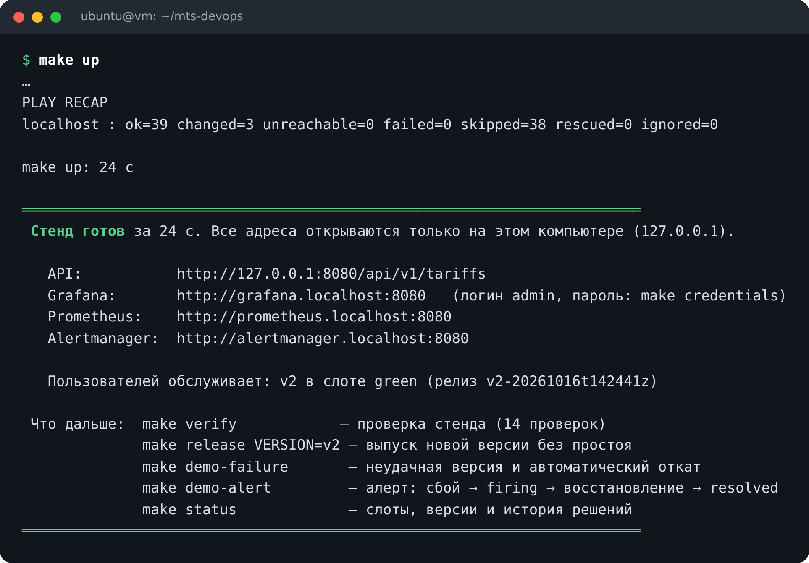
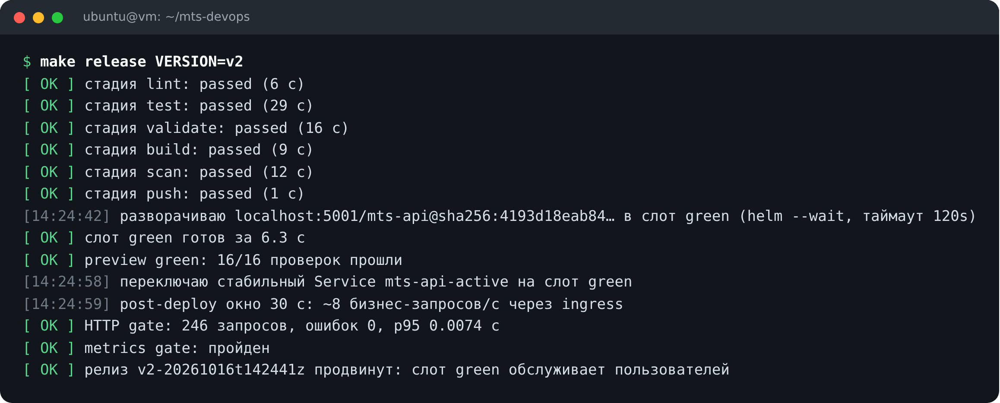
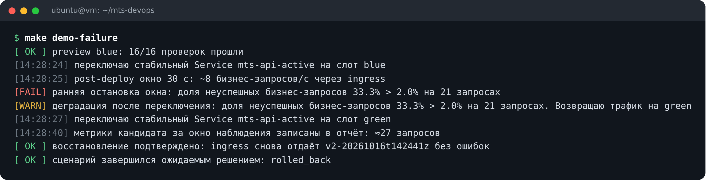
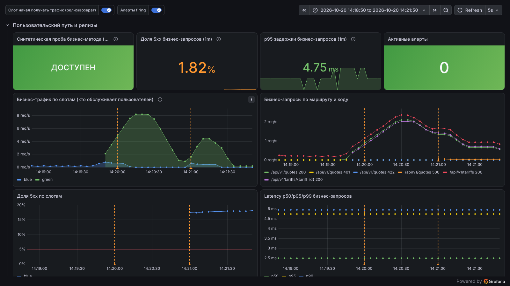
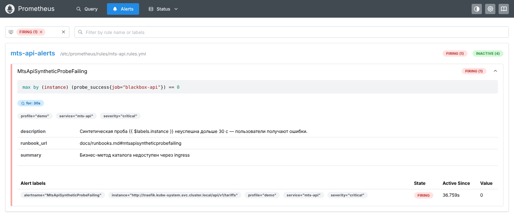
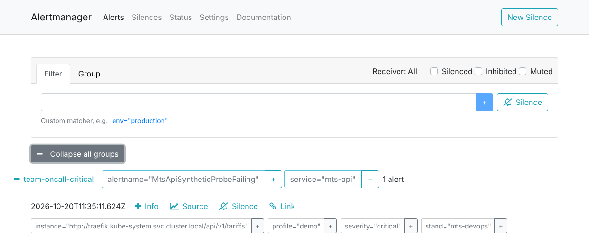
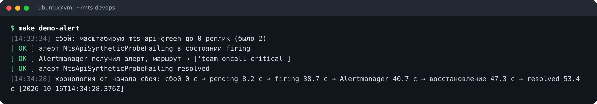
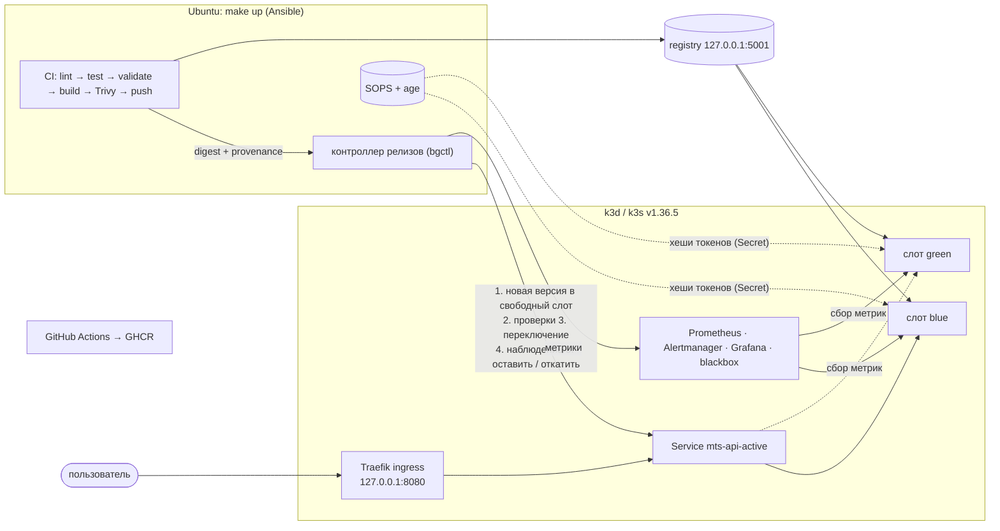

# DevOps-конвейер: от репозитория до Kubernetes за 3 команды

[](https://github.com/mitrcik/MTS_DEVOPS_TASK/actions/workflows/ci.yml)
[](https://github.com/mitrcik/MTS_DEVOPS_TASK/actions/workflows/compat.yml)

Команда **«Барни»** · кейс 1 конкурса DevOps МТС.

Одна команда `make up` поднимает на обычной Ubuntu готовую платформу доставки: Kubernetes,
CI-конвейер, мониторинг и алерты. Каждая новая версия сервиса проходит тесты и проверку
уязвимостей. Затем она запускается **рядом с рабочей** и проверяется до и после переключения
трафика. Если новая версия сломана, платформа **сама возвращает пользователей** на прежнюю версию
и пишет отчёт о том, что произошло.



## Быстрый старт

Нужна Ubuntu 22.04, 24.04 или 26.04 (x86_64 или arm64), 4 vCPU, 8 ГБ RAM и 40 ГБ диска. Подойдёт
обычная виртуальная машина. Пошаговая инструкция для ВМ — [`docs/vm-guide.md`](docs/vm-guide.md).

```bash
# один раз на чистой Ubuntu: Docker, Python и утилиты
sudo apt-get update && sudo apt-get install -y git make
git clone https://github.com/mitrcik/MTS_DEVOPS_TASK.git mts-devops && cd mts-devops
make prereqs && newgrp docker

# запуск стенда (3–6 минут при первом запуске)
make up
```

Если Docker, Python ≥ 3.12, git и make уже есть, хватает трёх команд: `git clone …`, `cd mts-devops`, `make up`.

## Что посмотреть за 5 минут

| Команда | Что происходит | Время |
|---|---|---|
| `make verify` | 14 проверок работающего стенда: API, токен, метрики, алерты, Grafana | ~1 с |
| `make release VERSION=v2` | новая версия: тесты → сборка → проверка уязвимостей → запуск рядом с рабочей → проверки → переключение трафика | 75–120 с |
| `make demo-failure` | версия с дефектом: после переключения появляются ошибки, трафик **автоматически возвращается** | ~45 с |
| `make demo-alert` | настоящий сбой: алерт срабатывает, приходит в Alertmanager и снимается после восстановления | ~55 с |
| `make rotate-secret` | замена API-токена без простоя: новый принимается, старый отклоняется | ~3 с |
| `make verify-security` | 17 проверок защиты: non-root, read-only, сетевые политики, права, шифрование секретов | ~10 с |
| `make status` | какая версия обслуживает пользователей и история решений | ~1 с |

Все 15 приёмочных сценариев подряд: `make test-e2e` (10–13 минут). Удалить стенд: `make down`.

## Как это выглядит

**Выпуск новой версии.** Каждый этап виден, решение принимается по фактическим проверкам:



**Неудачная версия.** Дефект проявляется только на реальном трафике. Платформа замечает ошибки за
2–3 секунды и возвращает пользователей на рабочую версию:



**Дашборд Grafana.** Три минуты: релиз v2 (трафик перешёл на слот green) и неудачная v3-faulty
(слот blue получил трафик на пару секунд, доля 5xx у него выросла, трафик вернулся на green).
Оранжевые метки — моменты, когда слот начал получать трафик:



**Алерт.** Реальный сбой → алерт в Prometheus → уведомление в Alertmanager → восстановление:







## Что проверено

- **15 из 15 приёмочных сценариев** на чистых виртуальных машинах GitHub: Ubuntu 24.04 x86_64 (на
  каждый push), Ubuntu 22.04 x86_64 и Ubuntu 24.04 arm64. Ещё один прогон — в окружениях Ubuntu
  22.04, 24.04 и 26.04 (пакеты и Python этих версий).
- **Холодный запуск** `make up` на чистой ВМ — 3 мин 17 с – 3 мин 40 с; повторный — около 20 с, ничего
  не меняет.
- **Откат:** дефект замечается за 2–3 с после переключения, трафик возвращается на рабочую версию
  за 0,3–1,4 с (обычно около 0,5 с), после возврата — 85–88 запросов подряд без ошибок.
- **Ресурсы:** пик памяти за полный прогон — около 2,2 ГиБ, на диске — около 9 ГБ.

Подробности и отчёты — [`docs/validation/`](docs/validation/), матрица требований —
[`docs/requirements.md`](docs/requirements.md).

---

## 1. Название кейса

«Облачный DevOps-конвейер: от репозитория до production-Kubernetes за 3 команды» (кейс 1).

## 2. Описание проблемы

Путь кода в production часто собран вручную. Образ собирают на ноутбуке разработчика, тег `latest`
перезаписывают, новую версию выкладывают поверх рабочей, а откатывают руками — после жалоб
пользователей. Секреты лежат открытым текстом, а метрики и алерты появляются позже первых
инцидентов. Такой процесс нельзя повторить и нельзя проверить: непонятно, какой именно артефакт
работает в production и как быстро вернуться к рабочей версии.

## 3. Цель работы

Сделать стенд, который поднимается тремя командами и в котором:

- каждое изменение проходит lint, тесты, проверку конфигурации, сборку, сканирование Trivy и
  публикацию **ровно того же** образа по его digest (уникальной контрольной сумме);
- релиз устроен по схеме blue-green: есть два слота, новая версия запускается в свободном, проверяется
  до и после переключения трафика, а при проблемах трафик автоматически возвращается;
- секреты хранятся зашифрованными (SOPS + age), а их замену можно проверить;
- есть метрики, дашборд, алерты и инструкции на случай инцидента, а каждый релиз оставляет отчёт.

## 4. Состав команды

Команда **«Барни»**:

| Участник |
|---|
| Кутузов Дмитрий Сергеевич |
| Рожков Иван Валерьевич |
| Джумабаев Али |

## 5. Архитектура



Как устроен релиз:

1. CI собирает образ, проверяет его сканером Trivy и публикует по digest. Вместе с образом
   сохраняется provenance — запись о том, что именно и с каким результатом проверялось.
2. Контроллер релизов запускает новую версию в **свободном** слоте. Пользователи в это время
   работают со старой версией.
3. Каждый экземпляр новой версии проверяется напрямую: здоровье, версия, бизнес-методы, отказ без
   токена, метрики. Prometheus должен видеть новую версию до переключения.
4. Трафик переключается одним действием, после чего 30 секунд идут реальные запросы через ingress и
   проверяются метрики. Если метрик нет, это считается провалом, а не успехом.
5. Если всё в порядке, версия остаётся. Если нет, трафик возвращается на прежний слот и
   восстановление подтверждается.

Подробнее: [`docs/architecture.md`](docs/architecture.md), обоснование решений —
[`docs/decisions.md`](docs/decisions.md).

**Демо-приложение** (`app/`): учебный каталог тарифов и расчёт месячной стоимости (данные
условные, это не тарифы МТС).

| Метод | Назначение |
|---|---|
| `GET /api/v1/tariffs`, `GET /api/v1/tariffs/{id}` | каталог тарифов (без авторизации) |
| `POST /api/v1/quotes` | расчёт стоимости; нужен заголовок `Authorization: Bearer <токен>`; неверный ввод — 422, неизвестный тариф — 404 |
| `GET /healthz`, `GET /readyz` | процесс жив / готов принимать запросы |
| `GET /version` | версия, Git SHA, время сборки, release id, слот |
| `GET /metrics` | метрики Prometheus |

Учебные дефекты для демонстраций (`FAULT=not-ready`, `FAULT=errors-behind-ingress`) включаются
только при сборке образа. По умолчанию они выключены, и включить их через API нельзя.

## 6. Использованные инструменты

Версии зафиксированы 2026-10-15: берётся последний стабильный выпуск, опубликованный не позже
2026-10-01 (решение D14). Всё, кроме Docker и Python, ставится внутрь проекта, в каталог `.local/`.

| Инструмент | Версия | Откуда и как проверяется |
|---|---|---|
| Ubuntu | 22.04 / 24.04 / 26.04 LTS, x86_64 или arm64 | основной профиль — 24.04 x86_64; что проверено — [`docs/vm-guide.md`](docs/vm-guide.md), раздел 8 |
| Docker Engine + buildx | ≥ 24 (проверены 29.8.2 и Docker CE 28.0.4; из пакетов Ubuntu `docker.io` 29.1.3 и `docker-buildx` 0.30.1 проверены CLI и buildx) | `make prereqs` ставит `docker.io` и `docker-buildx` из Ubuntu; уже установленный Docker CE не трогает |
| Python | ≥ 3.12 (проверены 3.12, 3.13, 3.14) | `python3-venv` из Ubuntu; на 22.04 — `python3.12` из PPA deadsnakes (`make prereqs`) |
| ansible-core / yamllint / ruff | 2.21.4 / 1.38.0 / 0.16.9 | PyPI, установка по хешам (`infra/tooling/requirements.lock`) |
| k3d | 5.9.0 | GitHub Releases, sha256 из `checksums.txt` (для всех CLI — сборки amd64 и arm64) |
| k3s | v1.36.5+k3s1 | образ `rancher/k3s` |
| kubectl | 1.36.5 | dl.k8s.io, sha256 |
| Helm | 4.3.0 | get.helm.sh, sha256 |
| SOPS / age | 3.13.1 / 1.3.1 | GitHub Releases, sha256 |
| Trivy | 0.75.0 (база уязвимостей — mirror.gcr.io) | GitHub Releases, sha256 |
| Traefik | 3.7.13 | встроен в k3s |
| Registry | 3.1.2 | образ `registry:3.1.2` |
| Prometheus / Alertmanager | v3.13.4 / v0.34.1 | образы `prom/*` |
| Grafana | 13.2.3 | образ `grafana/grafana` |
| blackbox exporter | v0.28.0 | образ `prom/blackbox-exporter` |
| Приложение | Python 3.13 на Alpine 3.24; FastAPI 0.142.2, uvicorn 0.54.0, prometheus-client 0.26.0, pydantic 2.13.5 | PyPI, установка по хешам (`app/requirements.lock`) |
| Тесты | pytest 9.1.1, httpx 0.28.1; shellcheck 0.11.0 | `app/requirements-dev.lock`, контейнер |
| GitHub Actions | checkout v7.0.1, upload-artifact v7.0.2, download-artifact v7.0.0 | закреплены по commit SHA |

Фактические версии печатает `make doctor`; источники — `infra/tools/tools.yml` и `versions.env`.

## 7. Как запустить

### Подготовка (один раз)

На чистой Ubuntu 22.04 / 24.04 / 26.04, в том числе на виртуальной машине (подробно —
[`docs/vm-guide.md`](docs/vm-guide.md)):

```bash
sudo apt-get update && sudo apt-get install -y git make
git clone https://github.com/mitrcik/MTS_DEVOPS_TASK.git mts-devops && cd mts-devops
make prereqs        # Docker + buildx, Python ≥ 3.12, лимиты inotify (спросит пароль sudo)
newgrp docker       # или выйти из сеанса и войти снова
make doctor         # проверка готовности; итог — «обязательные проверки пройдены»
```

Нужно: 4 vCPU, 8 ГБ RAM (в покое стенд занимает около 1,6 ГиБ), 40 ГБ диска у ВМ (проекту нужно
около 10 ГБ), доступ в интернет (Docker Hub, ghcr.io, GitHub, dl.k8s.io, get.helm.sh, PyPI, mirror.gcr.io;
полный список — [`docs/vm-guide.md`](docs/vm-guide.md)). Свободные порты на `127.0.0.1`: 8080, 6550, 5001.
Домен, публичный IP, правка `/etc/hosts` и токен GitHub **не нужны**.

### Три команды

```bash
git clone https://github.com/mitrcik/MTS_DEVOPS_TASK.git mts-devops
cd mts-devops
make up
```

Что делает `make up` (повторный запуск безопасен):

1. проверяет хост (`make doctor`): ОС, Docker, ресурсы, диск, порты, доступ к источникам;
2. ставит инструменты в `.local/` с проверкой контрольных сумм;
3. создаёт age-ключ и зашифрованные учебные секреты (если их ещё нет);
4. поднимает кластер k3d с registry и шифрованием секретов;
5. настраивает платформу: Pod Security, сетевые политики, права для релизов;
6. разворачивает мониторинг: Prometheus, Alertmanager, Grafana;
7. собирает и выпускает первую версию `v1` через весь конвейер;
8. проверяет стенд и печатает адреса.

В конце выводится сводка «Стенд готов» с адресами и активной версией (снимок — в начале README).
Холодный запуск на чистой ВМ занимает 3 мин 17 с – 3 мин 40 с.

| Адрес (только на этом компьютере) | Что |
|---|---|
| http://127.0.0.1:8080/api/v1/tariffs | API; также `/version` и `/docs` |
| http://grafana.localhost:8080 | Grafana (логин `admin`, пароль — `make credentials`) |
| http://prometheus.localhost:8080 | Prometheus |
| http://alertmanager.localhost:8080 | Alertmanager |

Если стенд на ВМ без графики, откройте адреса через SSH-туннель:
`ssh -L 8080:127.0.0.1:8080 <пользователь>@<IP ВМ>`.

### Все команды

| Команда | Что делает |
|---|---|
| `make prereqs` | один раз на чистой Ubuntu: Docker + buildx, Python, утилиты (через sudo) |
| `make up` / `make doctor` | запуск стенда / диагностика без изменений |
| `make verify` / `make verify-security` | проверка стенда / проверка мер защиты |
| `make release VERSION=v2` | выпуск новой версии через весь конвейер |
| `make demo-failure` | версия с дефектом → автоматический откат |
| `make demo-not-ready` | версия, которая не запускается → отказ до переключения |
| `make demo-no-metrics` | Prometheus недоступен → релиз отклонён (без метрик нет успеха) |
| `make demo-alert` | реальный сбой → алерт → восстановление |
| `make rotate-secret` | замена API-токена |
| `make recover` | восстановление после прерванного релиза |
| `make status` / `make credentials` | состояние слотов и история / учебные пароль и токен |
| `make ci` | все стадии CI локально (для публикации нужен работающий стенд) |
| `make test-e2e` | 15 приёмочных сценариев (10–13 минут) |
| `make down` | удалить кластер, registry и образы проекта; ключ и секреты сохраняются |
| `make down PURGE=1 CONFIRM=yes` | удалить ещё и секреты, age-ключ и отчёты (необратимо) |

Настройки (порты, имя кластера, пороги проверок, зеркала для закрытых сетей) — в файле `.env`,
он создаётся из [`.env.example`](.env.example).

### Что сделано и как проверить

| Возможность | Где в коде | Как проверить | Ожидаемый результат |
|---|---|---|---|
| Подготовка чистой ВМ | `scripts/install-prereqs.sh` | `make prereqs` → `make doctor` | «предпосылки готовы», doctor без ошибок |
| Запуск тремя командами | `Makefile`, `infra/ansible/` | `make up` | сводка «Стенд готов» |
| CI на каждый push | `.github/workflows/ci.yml`, `scripts/ci.sh` | вкладка Actions; локально `make ci` | все стадии `passed` |
| Политика Trivy | `scripts/cihelper.py`, `.trivyignore.yaml` | `cat .local/artifacts/*/trivy-summary.json` | `result: passed`, версия и дата базы |
| Blue-green релиз | `charts/app`, `charts/traffic`, `scripts/pylib/release.py` | `make release VERSION=v2` | `promoted`, трафик на другом слоте |
| Отказ до переключения | то же | `make demo-not-ready` | `rejected`, пользователи на прежней версии |
| Автоматический откат | то же | `make demo-failure` | `rolled_back`, восстановление подтверждено |
| Без метрик нет успеха | `scripts/pylib/gate.py` | `make demo-no-metrics` | `rejected: metrics_unavailable` |
| Отчёт о релизе | `scripts/pylib/report.py` | `ls .local/reports/` | JSON и Markdown на каждый релиз |
| Секреты и их замена | `scripts/pylib/secrets.py`, `rotation.py` | `make rotate-secret` | старый токен отклоняется (401) во всех экземплярах |
| Защита рантайма и сети | `charts/*` | `make verify-security` | 17/17 |
| Дашборд и алерты | `observability/` | `make verify`, `make demo-alert` | 15 панелей; firing → resolved |
| Защита от одновременных изменений | `scripts/pylib/lock.py` | сценарий `concurrency` в `make test-e2e` | второй запуск получает отказ (код 10) |
| Удаление стенда | `scripts/down.sh` | `make down` | контейнеров кластера не осталось |
| Совместимость Ubuntu 22.04–26.04, x86_64/arm64 | `.github/workflows/compat.yml` | вкладка Actions → `compat` | все задания зелёные, 15/15 в каждом окружении |

## 8. Мониторинг и наблюдаемость

- **Что собирается.** Метрики приложения (каждые 5 с, с метками слота, версии и экземпляра);
  синтетическая проба бизнес-метода `GET /api/v1/tariffs` через ingress (blackbox, каждые 5 с);
  CPU и память контейнеров; метрики Traefik, Grafana и Alertmanager. Конфигурация, правила и дашборд
  хранятся как код в [`observability/`](observability/).
- **Дашборд** «MTS DevOps — демо-API» в Grafana: доступность, доля ошибок 5xx, задержки p50/p95/p99,
  трафик по слотам с отметками переключений и алертов, версии экземпляров, ресурсы.
- **Алерты** ([`observability/files/rules/mts-api.rules.yml`](observability/files/rules/mts-api.rules.yml)):
  `MtsApiSyntheticProbeFailing` (critical: бизнес-метод недоступен через ingress 30 с),
  `MtsApiSyntheticProbeAbsent` (нет данных пробы), `MtsApiHighErrorRate` (больше 5% ошибок 5xx),
  `MtsApiHighLatencyP95` (p95 больше 500 мс), `MtsApiTargetDown`. Critical-алерты идут получателю
  `team-oncall-critical`, остальные — `team-default`. Что делать по каждому алерту —
  [`docs/runbooks.md`](docs/runbooks.md). Правила проверены `promtool test rules`.
- **Как увидеть алерт:** `make demo-alert` останавливает экземпляры активной версии, ждёт
  срабатывания алерта и его доставки в Alertmanager, затем восстанавливает сервис и ждёт снятия
  алерта. В прогонах алерт срабатывал через 32–39 с после сбоя и снимался через 3–10 с после восстановления.
  Для показа зрителям: `make demo-alert HOLD=60` держит сбой ещё 60 с после доставки алерта, чтобы
  успеть открыть Prometheus, Alertmanager и Grafana.
- **Учебные цели качества (SLI/SLO):** доступность бизнес-метода ≥ 99% за 5 минут, ошибки 5xx < 1%
  (порог алерта 5%, порог проверки релиза 2%), p95 < 250 мс (порог алерта 500 мс). Обычный p95
  этого сервиса — 5–10 мс.

## 9. Безопасность

Подробно и с командами проверки — [`docs/security.md`](docs/security.md).

- **Секреты:** SOPS + age. Закрытый ключ лежит вне проекта (`~/.config/mts-devops/<cluster>/age.key`,
  права 0600), открытый текст на диск не пишется. В кластере хранятся только SHA-256 токенов, а k3s
  дополнительно шифрует секреты в своей базе.
- **Замена токена:** `make rotate-secret` — сначала новый токен добавляется к старому, затем он
  проверяется во всех экземплярах обоих слотов, и только потом старый отзывается. Откат версии не
  возвращает отозванный токен.
- **Контейнеры:** Pod Security `restricted`, запуск не от root (UID 10001), файловая система только
  для чтения, без лишних прав Linux, без токена Kubernetes.
- **Сеть:** всё запрещено по умолчанию; приложение принимает запросы только от ingress и Prometheus
  и само ходит только в DNS. Это проверяет `make verify-security`. Все адреса стенда открыты только
  на `127.0.0.1`.
- **Права:** администраторский доступ к кластеру используется только при подготовке; релизы идут от
  отдельной учётной записи с правами в одном namespace. В GitHub Actions — минимальные права,
  действия закреплены по SHA.
- **Цепочка поставки:** контрольные суммы всех загружаемых инструментов, зависимости по хешам,
  Trivy блокирует уязвимости HIGH/CRITICAL с исправлениями и секреты в образе, выкатывается только
  проверенный digest.

## 10. Использование LLM

Код, чарты, роли Ansible, workflow и документация писались с помощью Claude Code по мастер-промпту
команды ([`docs/llm/master-prompt.md`](docs/llm/master-prompt.md)). Всё проверено инструментами и
реальными запусками; сам стенд от LLM не зависит. Экономия времени не измерялась: не было замера
«до». Подробно — [`docs/llm-usage.md`](docs/llm-usage.md).

## 11. Troubleshooting

Начинайте с `make doctor`. Частые случаи (подробно — [`docs/troubleshooting.md`](docs/troubleshooting.md)):

| Симптом | Решение |
|---|---|
| `permission denied … docker.sock` | группа docker ещё не действует: `newgrp docker` или перелогиньтесь |
| порт 8080, 6550 или 5001 занят | поменять `INGRESS_PORT` / `API_PORT` / `REGISTRY_PORT` в `.env`, затем `make down && make up` |
| `toomanyrequests` от Docker Hub | `docker login` или зеркало (`DOCKERHUB_MIRROR` в `.env`) |
| ошибки `x509` за корпоративным прокси | `EXTRA_CA_BUNDLE=/путь/ca-bundle.crt` в `.env` |
| сразу после перезагрузки «кластер недоступен» | подождать 1–2 минуты (стенд поднимается сам), при необходимости `make up` |
| `another operation … in progress` (Helm) | `make recover` |
| релиз отклонён `metrics_unavailable` | Prometheus недоступен — это защитное поведение; проверьте `make verify` |

## 12. Лицензия

[MIT](LICENSE) © 2026 Кутузов Дмитрий Сергеевич, Рожков Иван Валерьевич, Джумабаев Али.

---

### Ограничения

- Стенд однонодовый: это учебная платформа, а не отказоустойчивый production-кластер; HTTP без TLS
  только на `127.0.0.1`.
- Виртуальная машина не создаётся автоматически (Terraform, cloud-init). Организаторы разрешили
  k3d с одной нодой вместо ВМ; готовая ВМ подготавливается командой `make prereqs`.
- Доставка на постоянный удалённый стенд по SSH настроена, но не проверена: такого хоста у команды
  нет ([`docs/remote-cd.md`](docs/remote-cd.md)).
- Видео-демонстрация не записана; сценарий — [`docs/demo-script.md`](docs/demo-script.md).

Материалы к защите — [`docs/defense-notes.md`](docs/defense-notes.md).
