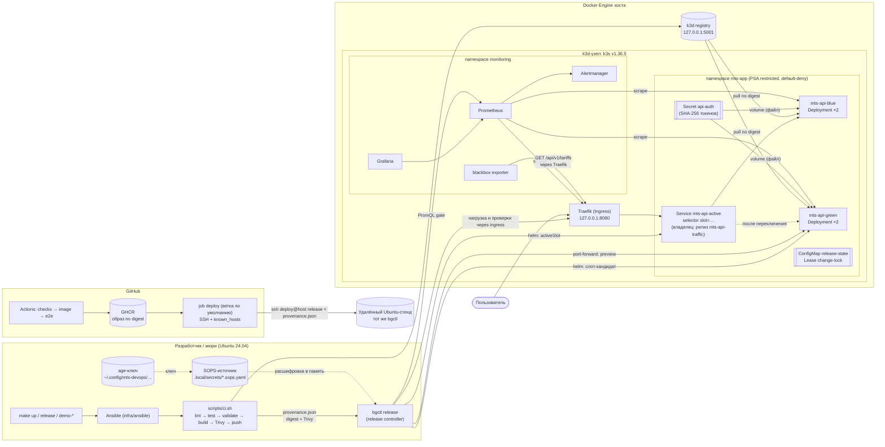
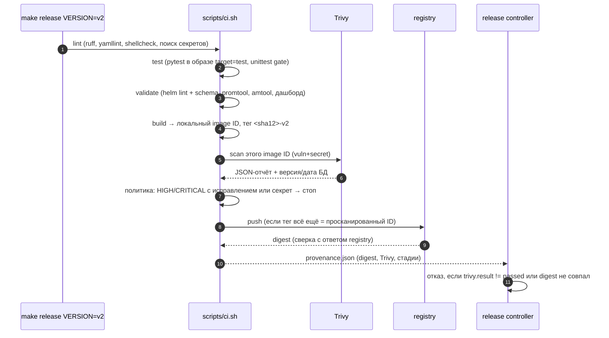
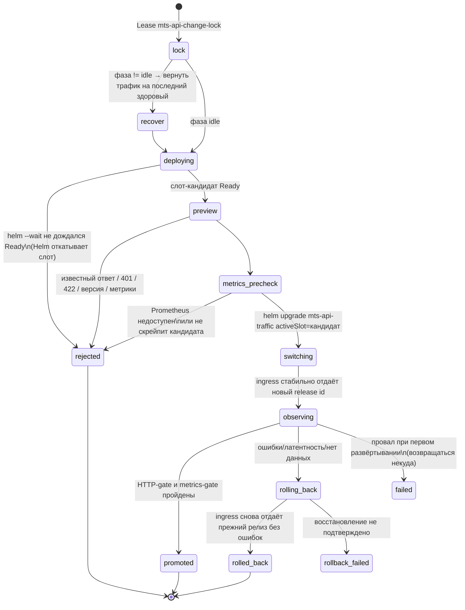
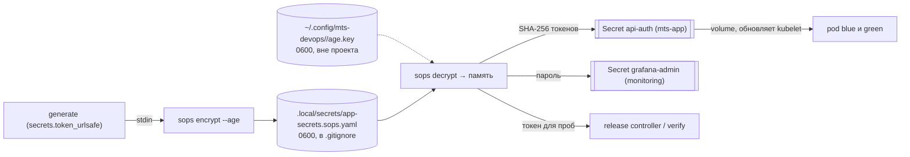

# Архитектура

Документ описывает, из каких частей состоит стенд, какой путь проходит образ от кода до кластера и
как устроен релиз blue-green. Почему выбраны именно эти решения, объясняет
[`decisions.md`](decisions.md).

## 1. Общая схема

Локальный стенд работает на одном хосте с Ubuntu. Внутри Docker запущены однонодовый кластер k3d (k3s)
и локальный registry образов. Команды `make` запускают Ansible, CI-скрипт и release controller
`bgctl` — собственный скрипт команды, который выкатывает, проверяет и при необходимости откатывает
релиз. Удалённый CD (GitHub Actions → SSH → постоянный стенд) реализован в конфигурации, но не
проверен на постоянном стенде: см. [`remote-cd.md`](remote-cd.md).

Обозначения: сплошные стрелки — поток данных и команд, пунктир — секреты и переключение трафика.

## 2. Компоненты и ответственность

| Компонент | Где | Ответственность |
|---|---|---|
| `make up` | `Makefile` → `scripts/playbook.sh` → `infra/ansible/up.yml` | запускает роли по порядку: preflight → tools → secrets → cluster → platform → observability → app → summary |
| Закреплённые инструменты | `infra/tools/tools.yml`, роль `tools` | загрузка kubectl, helm, k3d, sops, age, trivy с проверкой sha256 в `.local/bin` |
| Кластер | шаблон `roles/cluster/templates/k3d-cluster.yaml.j2` | k3s 1.36.5, registry, `--secrets-encryption`, порты только на loopback |
| Платформа | `charts/platform` | namespace с PSA `restricted`, default-deny NetworkPolicy, RBAC `release-controller` |
| Слот | `charts/app` | Deployment/Service/ServiceAccount/NetworkPolicy одного слота, образ только по digest |
| Маршрутизация | `charts/traffic` | **единственный** владелец Service `mts-api-active` и Ingress |
| Наблюдаемость | `observability/` | Prometheus, Alertmanager, Grafana, blackbox; правила, дашборд, тесты promtool |
| CI | `scripts/ci.sh`, `scripts/cihelper.py` | стадии, политика Trivy, provenance |
| Release controller | `scripts/bgctl.py`, `scripts/pylib/release.py` | blue-green, gate, откат, отчёт |
| Секреты | `scripts/pylib/secrets.py`, `rotation.py` | SOPS/age, Secret, ротация с перекрытием |
| Удалённый CD | `.github/workflows/ci.yml` (job deploy), `scripts/remote/deploy-gate.sh` | SSH forced command на постоянном стенде |

## 3. Путь артефакта

Образ попадает в registry только после всех проверок CI: lint, тестов, валидации и сканирования
Trivy. Release controller принимает образ только вместе с `provenance.json` — файлом с digest
образа, результатом Trivy и списком стадий. Digest — неизменяемый хеш содержимого образа.

## 4. Релиз blue-green

Blue-green — два слота приложения (blue и green), трафик переключается между ними. Новый релиз
ставится в неактивный слот и проверяется. Трафик переходит на него только после проверок. Preview —
проверка слота-кандидата до переключения трафика. Gate — автоматическая проверка после
переключения, которая решает, оставить релиз или откатить его.

Ключевые свойства:

- **Рабочий слот не трогается.** Новый digest всегда разворачивается только в неактивный слот.
- **У маршрутизации один владелец.** Слоты никогда не владеют `mts-api-active`. Переключение и откат
  выполняет только release controller командой `helm upgrade mts-api-traffic --set activeSlot=…`.
- **Фактическое состояние читается из кластера.** Активный слот определяется по селектору живого
  Service, а не по локальным файлам. Поэтому релиз с другой машины видит тот же активный слот.
- **Прерывание.** При прерывании (Ctrl+C, обрыв SSH) в ConfigMap остаётся фаза
  `switching/observing/rolling_back`. Следующий запуск возвращает трафик на последний подтверждённый
  релиз и записывает `interrupted`.
- **Ready ≠ успешный релиз.** Readiness проверяет только процесс. Бизнес-проверки идут отдельно: в
  preview — напрямую на каждый pod, после переключения — через реальный ingress под нагрузкой.

## 5. Секреты

Секреты генерируются в памяти и сразу шифруются локально через SOPS и age, поэтому открытый текст
на диск не пишется. SOPS-файл расшифровывается только в память. Подробнее — в
[`security.md`](security.md).

Kubernetes хранит Secret в базе k3s (kine/sqlite) в зашифрованном виде (`--secrets-encryption`,
AES-CBC).

## 6. Наблюдаемость

| Источник | Метрики | Зачем |
|---|---|---|
| приложение `/metrics` (scrape каждые 5 с) | `http_requests_total{route,status}`, `http_request_duration_seconds_bucket`, `app_ready`, `app_build_info`, `quote_requests_total` | бизнес-трафик, ошибки, p95, версия и слот |
| blackbox (каждые 5 с) | `probe_success`, `probe_duration_seconds` | доступность бизнес-метода на пути пользователя |
| kubelet cAdvisor | `container_cpu_usage_seconds_total`, `container_memory_working_set_bytes` | CPU и RAM pod |
| Traefik | `traefik_*` | уровень ingress |

Метки `slot`, `version` и `pod` Prometheus берёт из меток pod (relabel). Метка маршрута — шаблон
пути FastAPI, а не конкретный URL.

## 7. Ограничения стенда и путь к HA

Стенд показывает практики доставки на одной машине. В таблице — что упрощено, почему это допустимо
для демо и как развивать решение до HA (высокой доступности).

| Ограничение | Почему допустимо для демо | Путь развития |
|---|---|---|
| один узел k3s, sqlite (kine) | стенд показывает практики доставки, а не отказоустойчивость | 3 server-узла k3s с embedded etcd, отдельные agent-узлы, anti-affinity слотов |
| локальный HTTP без TLS, `*.localhost` | всё работает на loopback | cert-manager + ACME или корпоративный CA, Traefik `websecure` |
| Prometheus без HA, хранение 2 дня / 1 ГБ | стенд рассчитан на 4 vCPU/8 ГБ | remote-write в долговременное хранилище, 2 реплики, Thanos/Mimir |
| Alertmanager без внешней доставки | внешняя доставка уведомлений не входит в кейс | email/Mattermost/Telegram в `files/alertmanager.yml` |
| stateless API, нет долгих соединений | у демо нет БД и WebSocket | для stateful — миграции «expand/contract», drain соединений |
| шифрование Secret ключом на том же узле | защищает дамп базы, но не узел | KMS-провайдер (Vault Transit / облачный KMS) |
