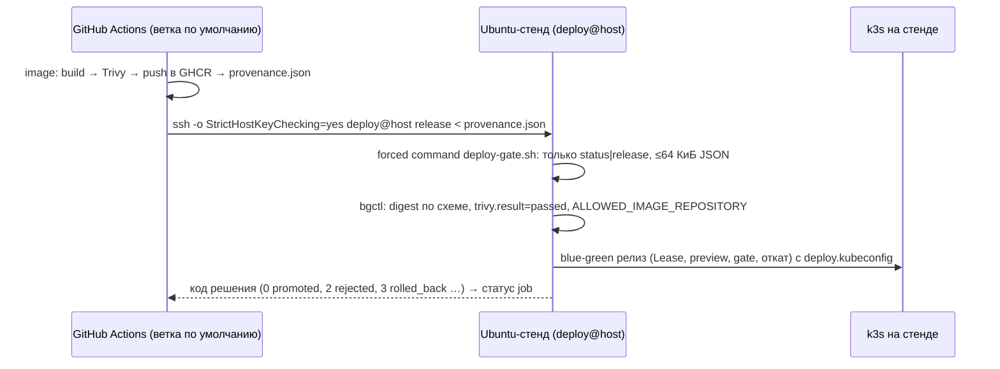

# Удалённый CD: GitHub Actions → постоянный стенд по SSH

> **Статус: реализовано в конфигурации, не проверено.** На момент сдачи у команды нет постоянного
> Ubuntu-хоста, доступного из GitHub. Пока не заданы переменные репозитория, job `deploy` в
> `.github/workflows/ci.yml` пропускается (`skipped`). Успешный E2E на одноразовом кластере внутри
> runner (ephemeral E2E) — это интеграционная проверка, а **не** доставка на постоянный стенд.

## Почему SSH, а не kubeconfig в workflow

У GitHub-hosted runner нет сетевого доступа к кластеру на ноутбуке или в закрытой сети. Передавать
admin-kubeconfig в публичный workflow нельзя. Поэтому runner не управляет кластером напрямую.

Вместо этого runner передаёт **проверенный артефакт** на выделенный Ubuntu-хост. Артефакт — это
provenance: файл с digest образа и результатом Trivy. На хосте работает тот же контроллер релизов
(release controller, `bgctl release`) с ограниченными правами в namespace `mts-app`.



## Подготовка стенда (один раз, выполняет администратор хоста)

1. Нужна Ubuntu 22.04–26.04. Создайте служебного пользователя стенда `deploy`. Он владеет
   `/opt/mts-devops` и состоит в группе `docker`. Вход по паролю закрыт. По ключу CI из шага 4
   доступна только forced command — заранее заданная команда, которую SSH выполняет вместо любой
   запрошенной.
   ```bash
   sudo apt-get update && sudo apt-get install -y git make
   sudo useradd -m -s /bin/bash deploy && sudo passwd -l deploy
   sudo install -d -o deploy -g deploy /opt/mts-devops
   sudo -iu deploy git clone https://github.com/<owner>/<repo>.git /opt/mts-devops
   sudo /opt/mts-devops/scripts/install-prereqs.sh    # Docker, buildx, Python — как make prereqs
   sudo usermod -aG docker deploy
   ```
2. Задайте настройки и запустите стенд от имени `deploy`:
   ```bash
   sudo -iu deploy bash -c 'cd /opt/mts-devops && cat > .env' <<'EOF'
   CLUSTER_NAME=mts-devops
   # только нижний регистр — так CI публикует ссылки на образы (сравнение тоже без учёта регистра)
   ALLOWED_IMAGE_REPOSITORY=ghcr.io/<owner>/<repo>/mts-api
   EOF
   sudo -iu deploy make -C /opt/mts-devops up
   ```
   `make up` поднимает стенд, создаёт секреты и ограниченный `deploy.kubeconfig`. age-ключ хранится
   вне проекта, в `~deploy/.config/mts-devops/`.

   Начальный релиз собирается в локальном registry. `ALLOWED_IMAGE_REPOSITORY` ему не мешает: эта
   переменная ограничивает только доставки через `deploy-gate.sh`.

   Токен в `deploy.kubeconfig` действует 7 дней. Продлить его можно той же командой
   `sudo -iu deploy make -C /opt/mts-devops up`.
3. Дайте узлу k3s доступ к GHCR. Если пакет приватный, добавьте read-only токен (`read:packages`) в
   `registries.yaml` k3s (`configs."ghcr.io".auth`). Другой вариант — сделать пакет публичным.
4. Добавьте ключ CI в `~deploy/.ssh/authorized_keys` только вместе с forced command:
   ```
   restrict,command="/opt/mts-devops/scripts/remote/deploy-gate.sh" ssh-ed25519 AAAA… github-actions-deploy
   ```
   `restrict` запрещает port-forwarding, X11, agent и PTY. Forced command разрешает только `status`
   и `release < provenance.json`.
5. Получите отпечаток ключа хоста для `known_hosts`: `ssh-keyscan -t ed25519 host`. **Сверьте** его
   с выводом `ssh-keygen -lf /etc/ssh/ssh_host_ed25519_key.pub` на самом хосте.
6. Публичный доступ к UI не открывается: ingress остаётся на loopback (`127.0.0.1`). Для внешнего
   доступа нужны TLS (Traefik `websecure` и сертификат) и отдельное решение по аутентификации.

## Настройка GitHub (один раз)

| Где | Имя | Значение |
|---|---|---|
| Settings → Environments | `production` | желательно включить required reviewers (ручное подтверждение деплоя) |
| Variables | `DEPLOY_HOST` | адрес стенда |
| Variables | `DEPLOY_USER` | `deploy` |
| Secrets (environment `production`) | `DEPLOY_SSH_KEY` | закрытый ключ ed25519 только для деплоя |
| Secrets (environment `production`) | `DEPLOY_KNOWN_HOSTS` | строка `known_hosts` из шага 5 |

## Границы полномочий

- **Runner** имеет только право `contents: read`. Он не получает kubeconfig и не видит секреты
  приложения.
- **`deploy@host`** может выполнить одну forced command. Контроллер релизов работает с
  `deploy.kubeconfig`: Role в `mts-app`, без exec, узлов и других namespace.
- **Компромисс этой схемы.** Процесс `release` выполняется от пользователя стенда. Этот пользователь
  состоит в группе `docker`, а на этом хосте это равнозначно root. Кроме того, на диске стенда лежит
  `admin.kubeconfig`.

  Граница доверия для CI — forced command и проверка входных данных: provenance не больше 64 КиБ,
  ссылка на образ только по digest, `trivy.result=passed`, совпадение digest,
  `ALLOWED_IMAGE_REPOSITORY`.

  Релиз можно было бы запускать от отдельного пользователя без Docker. Но тогда после каждого
  `make up` ему пришлось бы заново выдавать доступ к `deploy.kubeconfig`, SOPS-источнику и age-ключу:
  файл пересоздаётся с правами 0600. В проекте это не реализовано.
- **Одновременные запуски** исключены на двух уровнях: `concurrency: deploy-production`
  (cancel-in-progress: false) в GitHub и блокировка через объект Lease в самом кластере. Lease
  защищает и от ручного релиза на стенде в то же время.
- Начатое переключение не прерывается новым коммитом.
