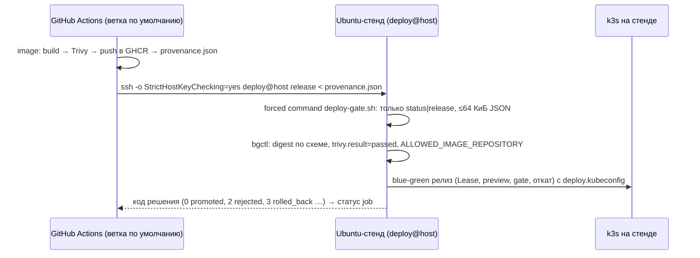

# Удалённый CD: GitHub Actions → постоянный стенд по SSH

> **Статус: реализовано в конфигурации, не проверено.** У команды на момент сдачи нет постоянного
> Ubuntu-хоста, доступного из GitHub. Job `deploy` в `.github/workflows/ci.yml` пропускается
> (`skipped`), пока не заданы переменные репозитория. Успешный ephemeral E2E в runner — это
> интеграционная проверка, а **не** доставка на постоянный стенд.

## Почему SSH, а не kubeconfig в workflow

GitHub-hosted runner не имеет сетевого доступа к кластеру на ноутбуке или в закрытой сети, а
передавать admin-kubeconfig в публичный workflow нельзя. Поэтому runner не управляет кластером
напрямую: он передаёт **проверенный артефакт** (provenance с digest и результатом Trivy) на
выделенный Ubuntu-хост, где работает тот же release controller (`bgctl release`) с ограниченными
правами в namespace `mts-app`.



## Подготовка стенда (однократно, администратор хоста)

1. Ubuntu 22.04–26.04. Служебный пользователь стенда `deploy` владеет `/opt/mts-devops`, состоит в
   группе `docker`, вход по паролю закрыт (по ключу CI из шага 4 — только forced command):
   ```bash
   sudo apt-get update && sudo apt-get install -y git make
   sudo useradd -m -s /bin/bash deploy && sudo passwd -l deploy
   sudo install -d -o deploy -g deploy /opt/mts-devops
   sudo -iu deploy git clone https://github.com/<owner>/<repo>.git /opt/mts-devops
   sudo /opt/mts-devops/scripts/install-prereqs.sh    # Docker, buildx, Python — как make prereqs
   sudo usermod -aG docker deploy
   ```
2. Настройки и запуск стенда от имени `deploy`:
   ```bash
   sudo -iu deploy bash -c 'cd /opt/mts-devops && cat > .env' <<'EOF'
   CLUSTER_NAME=mts-devops
   # только нижний регистр — так CI публикует ссылки на образы (сравнение тоже без учёта регистра)
   ALLOWED_IMAGE_REPOSITORY=ghcr.io/<owner>/<repo>/mts-api
   EOF
   sudo -iu deploy make -C /opt/mts-devops up
   ```
   `make up` поднимет стенд, создаст секреты и ограниченный `deploy.kubeconfig`; age-ключ — вне
   проекта, в `~deploy/.config/mts-devops/`. Начальный релиз собирается в локальном registry:
   `ALLOWED_IMAGE_REPOSITORY` ограничивает только доставки через `deploy-gate.sh`. Продление токена
   `deploy.kubeconfig` (7 дней) — тем же `sudo -iu deploy make -C /opt/mts-devops up`.
3. Доступ узла k3s к GHCR: если пакет приватный — read-only токен (`read:packages`) в
   `registries.yaml` k3s (`configs."ghcr.io".auth`), либо сделать пакет публичным.
4. Ключ CI — только с forced command, в `~deploy/.ssh/authorized_keys`:
   ```
   restrict,command="/opt/mts-devops/scripts/remote/deploy-gate.sh" ssh-ed25519 AAAA… github-actions-deploy
   ```
   `restrict` запрещает port-forwarding, X11, agent и PTY; forced command разрешает только
   `status` и `release < provenance.json`.
5. Отпечаток ключа хоста для `known_hosts`: `ssh-keyscan -t ed25519 host` — **сверить** с
   `ssh-keygen -lf /etc/ssh/ssh_host_ed25519_key.pub` на самом хосте.
6. Публичный доступ к UI не открывается: ingress остаётся на loopback; для внешнего доступа
   нужен TLS (Traefik `websecure` + сертификат) и отдельное решение по аутентификации.

## Настройка GitHub (однократно)

| Где | Имя | Значение |
|---|---|---|
| Settings → Environments | `production` | желательно required reviewers |
| Variables | `DEPLOY_HOST` | адрес стенда |
| Variables | `DEPLOY_USER` | `deploy` |
| Secrets (environment `production`) | `DEPLOY_SSH_KEY` | закрытый ключ ed25519 только для деплоя |
| Secrets (environment `production`) | `DEPLOY_KNOWN_HOSTS` | строка из шага 5 |

## Границы полномочий

- Runner: `contents: read`; не получает kubeconfig и не видит секреты приложения.
- `deploy@host`: одна forced command; release controller работает с `deploy.kubeconfig`
  (Role в `mts-app`, без exec, узлов и других namespace).
- Компромисс этой схемы: процесс `release` выполняется от пользователя стенда, а он в группе `docker`
  (на этом хосте это эквивалент root), и на диске стенда лежит `admin.kubeconfig`. Граница доверия для
  CI — forced command и проверка входных данных: provenance не больше 64 КиБ, ссылка только по digest,
  `trivy.result=passed`, совпадение digest, `ALLOWED_IMAGE_REPOSITORY`. Отдельный пользователь без Docker
  потребовал бы выдавать ему доступ к `deploy.kubeconfig`, SOPS-источнику и age-ключу заново после каждого
  `make up` (файл пересоздаётся с правами 0600) — в проекте это не реализовано.
- Конкурирующие запуски: `concurrency: deploy-production` (cancel-in-progress: false) в GitHub
  и Lease-блокировка в самом кластере (защищает и от одновременного ручного релиза на стенде).
- Начатое переключение не прерывается новым коммитом.
